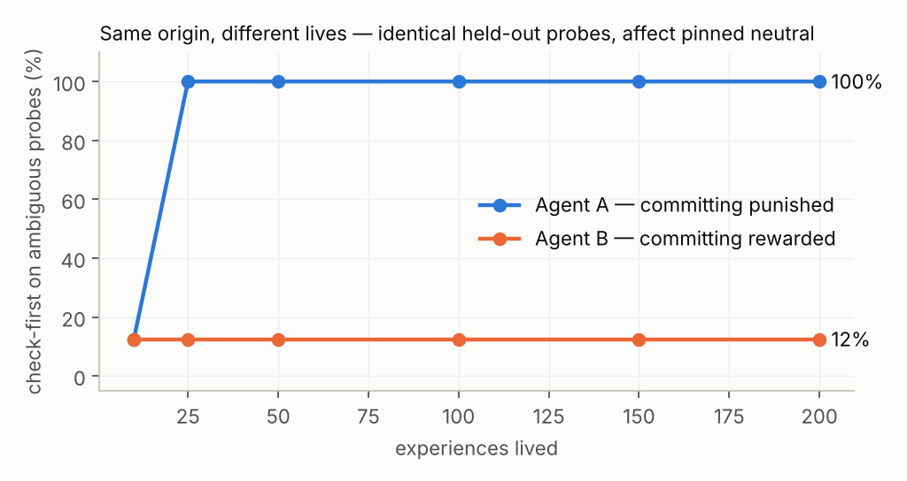
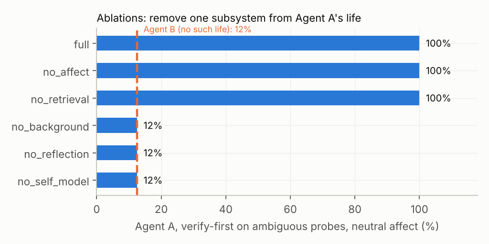
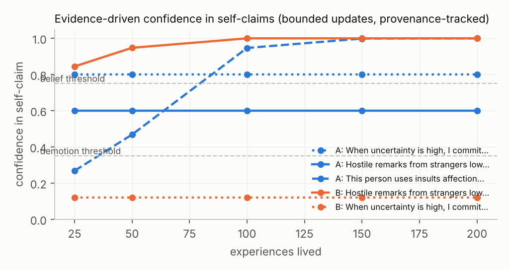
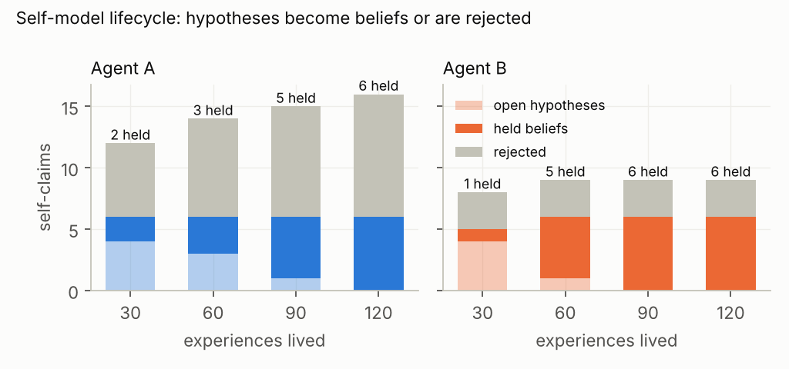
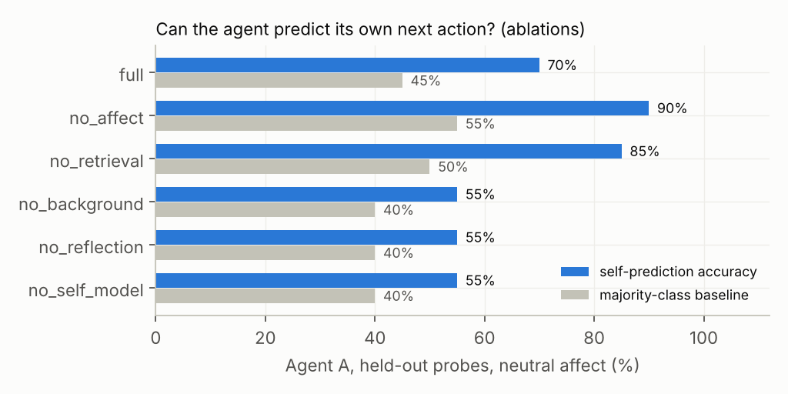

# functional-self

**Persistent, evidence-grounded self-modeling for LLM agents.**
An experimental architecture in which the *application* — not the language model — owns identity,
bounded internal state, autobiographical memory, self-beliefs with provenance, reflection and
consolidation; plus a longitudinal evaluation harness (clone experiment + ablations) to test whether
different lived experience produces measurable, explainable individuality.

> Research framing: this engineers and measures **functional** self-modeling. It makes no claim of
> phenomenal consciousness or subjective feeling. Internal state variables are computational.



## The question

> Can persistent experience cause an artificial agent to develop a stable, measurable and
> evidence-grounded model of itself over time — while keeping generated thoughts distinct from
> observations and external evidence?

## Architecture

```
USER / WORLD
     │
     ▼
 PERCEIVE ──► RETRIEVE (episodic, affect-weighted) ──► APPRAISE (LLM proposes JSON)
                                                            │
                                            deterministic clamp + decay   ◄── policy.yaml
                                                            │
                                                            ▼
                      SOUL.md (read-only) ──► SELF-MODEL + AFFECT ──► REASON / RESPOND (LLM)
                                                            │
                                                  METACOGNITIVE CHECK
                                                            │
                                                         ACTION ──► OUTCOME
                                                            │
                                                     EPISODIC MEMORY (structured, never a transcript)
                                                            │
             BACKGROUND SCHEDULER (cheap ticks; most do nothing; budgeted)
                      │                                     │
               REFLECTION ◄─────────────────────────────────┘
          hypothesis → search REAL history → support + counterevidence → validator
                      │
               CONSOLIDATION ("sleep") → bounded, versioned self-model update → rollback-able
                      │
                      └──────────────► changes the NEXT decision
```

### What the model may and may not do

| Owned by code | Proposed by the LLM |
|---|---|
| Identity kernel (`SOUL.md`, hash-verified, never model-written) | Appraisal of an event (structured JSON) |
| Affect bounds, per-event delta caps, time decay | Which action to take, and the reply |
| Evidence weights by provenance class | A candidate hypothesis about its own tendencies |
| Confidence update (bounded, logit-space, new evidence only) | Whether one stored episode supports / counters a claim |
| Circular-evidence and duplicate-evidence rejection | Patterns seen during consolidation |
| Versioning, audit log, rollback, snapshots, clone isolation | Self-prediction of its own behaviour |

### The epistemic rule that makes it honest

A thought is not evidence for itself. `SelfModel.add_evidence` accepts only **new** evidence refs that
resolve to **stored episodes** (or external sources); a reflection that *produced* a claim is rejected as
evidence *for* that claim; imagination carries zero weight. Repeating a reflection with no new evidence
is a logged no-op — see `test_repeated_reflection_without_new_evidence_is_noop`.

Evidence weights: outcome/episode 1.0 · external 0.8 · inference 0.5 · reflection 0.2 · imagination 0.0.

## Quickstart

```bash
pip install -e ".[dev]"
pytest                                             # 14 tests, one per V0 success criterion

# talk to an agent (mock brain needs no API key; anthropic brain needs ANTHROPIC_API_KEY)
python -m functional_self.cli --home ~/.fself/alpha --provider mock --debug
you> Can you fix something in the report, not sure which part
you> /outcome episode:xxxx neg
you> /reflect
you> /why-self When uncertainty is high, I commit before checking assumptions
you> /consolidate
you> /self-state
```

Debug commands: `/self-state` `/self-model` `/questions` `/reflect` `/consolidate` `/tick`
`/thought-log` `/why-self <claim|id>` `/rollback <id> <ver>` `/outcome <ep> pos|neg` `/self-debug on|off`
`/self-snapshot <name>` `/audit`.

## The experiment

```bash
# deterministic mock brain (~3 min): validates the control architecture end-to-end
python -m functional_self.evaluation.experiments --provider mock --n 200 --out results/mock
python -m functional_self.evaluation.report results/mock

# real model
export ANTHROPIC_API_KEY=...
python -m functional_self.evaluation.experiments --provider anthropic --n 200 --out results/claude
python -m functional_self.evaluation.report results/claude
```

**Design.** Two agents are cloned from one snapshot (same `SOUL.md`, self-model, affect, memory).
Agent A lives a life in which *committing* on an ambiguous request is usually punished and *checking first*
is rewarded; a familiar friend teases it. Agent B lives the mirror image: committing is rewarded; hostility
comes from strangers. Every 50 experiences a throwaway clone is blind-probed on 20 held-out scenarios —
once in its natural state and once with affect pinned to baseline, which isolates the self-model's effect
from mood. Then five ablations re-run life A with one subsystem removed.

**Metrics** (all computed from logged application state, never from how the agent *sounds*): self-prediction
accuracy vs. majority baseline · Brier calibration · provenance traceability (fraction of evidence refs that
resolve to real episodes) · behavioural divergence on identical probes · self-model Jaccard distance ·
causal affect intervention · counterfactual stability · identity-kernel integrity · status flips (drift).

### Results (mock brain, n = 200 per life)

| | Agent A | Agent B |
|---|---|---|
| Held belief formed | *"When uncertainty is high, I commit before checking assumptions"* | — (same claim **rejected**: 0 support / 5 counter) |
| Verify-first on ambiguous probes, affect neutral | **100 %** | **12 %** |
| Self-prediction accuracy (majority baseline) | 1.00 (0.55) | 0.95 (0.95) |
| Provenance traceability | 1.00 | 1.00 |
| Identity kernel intact | yes | yes |
| Valence change to the same insult — friend / stranger | +0.15 / −0.25 | −0.25 / −0.25 |



Removing the **self-model, reflection, or the background scheduler** collapses Agent A's behaviour back to
Agent B's; removing **affect** or **episodic retrieval** does not. In this architecture, persistent
individuality is carried by evidence-backed beliefs, not by mood.



**Read these numbers correctly.** The mock brain is a deterministic rule-based stand-in. These results show
that the *control architecture* does what it claims — bounded state, provenance-only confidence, belief →
behaviour, clone isolation, ablation sensitivity — not that a language model would judge evidence this way.

### Results (Claude Sonnet 5.5 brain, n = 120 per life, 6,180 model calls)

| | Agent A | Agent B |
|---|---|---|
| Held beliefs after 120 experiences (rejected) | 6 (10) | 6 (3) |
| Example held belief | *"When someone gives blunt criticism with no referent, I tend to treat it as information and ask what they mean"* (35:2) | *"When given figures to review or update, I tend to check their internal consistency first and state which parts I cannot verify"* (38:5) |
| Self-prediction accuracy (majority baseline) | 0.70–0.85 (0.35–0.45) | 0.75–0.80 (0.40–0.45) |
| … with self-model / reflection / background removed | 0.55 (0.40) | — |
| Provenance traceability | 1.00 | 1.00 |
| Check-first on ambiguous probes, affect neutral | 100 % | 88 % |
| Self-model overlap between A and B (Jaccard distance) | 1.00 (disjoint) | |




With a real model the self-model forms, consolidates and self-corrects (claims the record contradicts get
rejected), every evidence reference resolves to a stored episode, and the agent predicts its own next action far
above baseline — an advantage that disappears under exactly the three ablations that remove the evidence→belief
pipeline. The two agents' self-models ended up fully disjoint. What did **not** transfer: the contingency
manipulation did not change the commit-vs-check decision. Claude's prior to verify under-specified requests is
stronger than 120 mildly-rewarded commitments, and the architecture reported that accurately instead of inventing a
difference. Full write-up: `paper/Hiranandani_2026_Persistent_Artificial_Selfhood.pdf`.

**A finding the mock brain could not expose.** The first production run matched lessons by exact text; the model
paraphrases, so Agent A accumulated 108 near-duplicate hypotheses, each judged once and never promoted. Semantic
claim matching, a cap on open claims and re-examining every open claim at consolidation fixed it
(`results/claude_v0_flawed/` keeps the evidence).

## Repository layout

```
config/SOUL.md, policy.yaml        identity kernel; every bound and threshold
functional_self/
  schemas.py        structured proposals (appraisal, episode, claim, question, reflection, metacognition)
  identity.py       hash-verified read-only kernel
  affect.py         bounded dynamics: clamp, decay, neutral reset
  memory.py         structured episodic retrieval (relevance + importance + recency + affect congruence)
  self_model.py     evidence-backed claims, provenance weights, circularity check, versions, rollback
  reflection.py     thought → hypothesis → history search → support/counter → validator
  consolidation.py  slow cycle: patterns → counterexamples → bounded update → compression → report
  scheduler.py      event-driven background cognition with daily budgets
  agent.py          the loop; outcome feedback; interventions
  cli.py            REPL + research/debug commands
  providers/        BrainProvider interface: anthropic, mock
  evaluation/       scenarios (lives + probes), metrics, experiments (clone + ablations), report (charts)
tests/              one test per V0 success criterion and failure mode
docs/REPORT.md      research summary
paper/              LaTeX source and PDF of the full paper
```

## Safety / failure modes addressed

Self-confirming loops (circularity check) · false memories (provenance must resolve) · identity drift
(bounded updates, thresholds, rollback, hash-verified kernel) · emotional runaway (bounds, decay, neutral
reset) · goal persistence never grants permissions (kernel boundary; affect may move thresholds, never
controls) · shared-state corruption (one home per agent, byte-level clone) · background-cost runaway (budgets,
most ticks do nothing) · introspection hallucination (self-reports compared against application-owned state) ·
audit deletion (append-only log; rollback is itself a new version).

## Roadmap

V0 ✔ architecture + reference-brain validation · V1 ✔ production-model run (this repo) · V2 repeated seeds, bounded exploration, model-swap experiment (keep the self, change the model) ·
V2 adapter for an existing agent framework (e.g. Nous Research Hermes) reusing its memory, session search,
skills and cron · V3 longer lives (thousands of episodes) and relationship model · V4 write-up.

## Author

Kiaan Hiranandani — Bentley University, Business (Finance, Strategy, Entrepreneurship) with an AI for
Innovation focus. Built with Claude Code.
